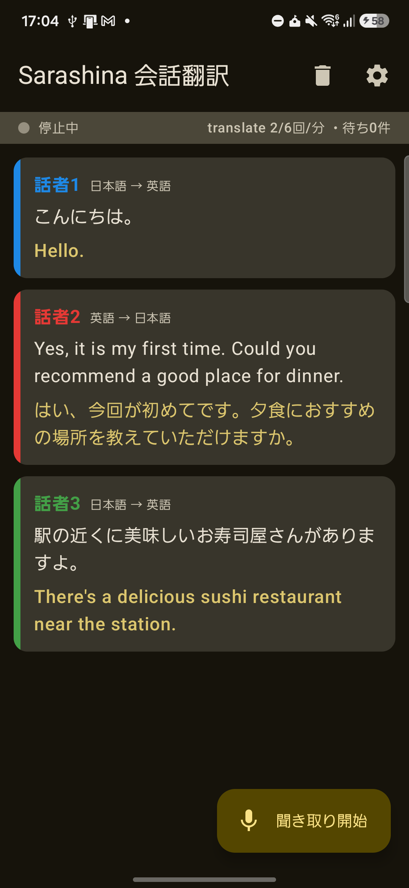

# Sarashina 会話翻訳（Sarashina_app_transrate）

Sarashina の翻訳モデル **sarashina3-translate** を使った、Android 向けのリアルタイム日英・英日会話翻訳アプリです。

スマホを会話の真ん中に置いておくと、マイクで聞き取った会話を**話した人ごとに聴き分けて**、原文と訳文をカードで表示します。

<p align="center">
  
</p>

- 🎙️ マイクで会話を聞き取り続ける
- 🗣️ 誰が話したかを自動で判別（「話者1」「話者2」…。名前も変えられます）
- 🌐 日本語か英語かを自動で判定し、日→英・英→日を切り替えて翻訳
- 🔒 音声は端末の外に出しません（Sarashina API に送るのは文字起こししたテキストだけ。[送ったテキストの扱い](#sarashina-api-の利用条件使う前に必ず確認してください)）
- 🔊 読み上げは今後追加予定

> [!NOTE]
> 個人が作っている非公式のアプリです。Sarashina および SB Intuitions 株式会社とは関係ありません。

---

## 目次

1. [必要なもの](#必要なもの)
2. [導入方法](#導入方法)
   - [A. APK をインストールする（かんたん）](#a-apk-をインストールするかんたん)
   - [B. ソースからビルドする（Android Studio なし）](#b-ソースからビルドするandroid-studio-なし)
   - [C. Android Studio でビルドする](#c-android-studio-でビルドする)
3. [使い方](#使い方)
4. [うまくいかないとき](#うまくいかないとき)
5. [仕組み](#仕組み)
6. [開発者向け情報](#開発者向け情報)
7. [ライセンス](#ライセンス)

---

## 必要なもの

| もの | 内容 |
|---|---|
| Android 端末 | Android 8.0 以上、マイク付き。arm64 の端末、RAM 4GB 以上をおすすめします |
| 空き容量 | 500MB 以上が目安（アプリ本体と音声モデル約 270MB） |
| ネット接続 | 初回のモデルダウンロード（Wi-Fi 推奨）と、翻訳のたびに使います |
| Sarashina の API キー | 自分で発行したものを使います（下の手順を参照） |

### API キーの発行

1. [Sarashina のダッシュボード（API Keys）](https://chat.sarashina.ai/dashboard/api-keys) にログインします（Google アカウントでログインできます）。
2. 新しい API キーを作り、コピーしておきます。

### Sarashina API の利用条件（使う前に必ず確認してください）

このアプリは、使う人それぞれが**自分の API キー**で Sarashina API を呼び出します。
API キーを発行すると [Sarashina サービス利用規約](https://sarashina.ai/terms) に同意したことになるので、特に次の点に注意してください。

| 項目 | 内容 | 規約 |
|---|---|---|
| 料金 | 2026 年 10 月 13 日に始まった**無償ベータ版**として無料で使えます。終了時期は未定です（[発表](https://www.sbintuitions.co.jp/news/press/20261013_01/)） | 第2条・第5条 |
| 使える人 | **日本国内に住んでいる個人**、または日本国内に本店がある法人だけです。18 歳未満は保護者の同意が必要です | 第3条 |
| 話した内容の扱い | 翻訳のために送ったテキストと訳文は、**Sarashina のモデルの学習などに使われることがあります**。無償プランでは学習への利用を断れません | 第9条・第11条 |
| 話してはいけないこと | **個人を特定できる情報**（氏名と住所・電話番号の組み合わせなど）、機密情報、他人の著作物などは入力禁止です。会話を翻訳するときも気をつけてください | 第10条・第22条 |
| API キー | 他人に教えたり、共有したりしてはいけません。他人がキーを使った場合も、キーの持ち主の利用とみなされます | 特記事項 第1条 |
| レート制限 | 上限を超えて使ってはいけません（このアプリは上限を守るように作っています）。上限を避けるために複数アカウントを作るのも禁止です | 第7条・第10条 |
| 訳文の正確さ | 正確さは保証されません。医療・法律など重要な場面では、訳文だけに頼らないでください | 第10条・第25条 |

上の表は要約です。正式な内容は必ず[利用規約の原文](https://sarashina.ai/terms)を確認してください。

---

## 導入方法

### A. APK をインストールする（かんたん）

1. このリポジトリの [Releases](https://github.com/kono0/Sarashina_app_transrate/releases) から、最新の `.apk` ファイルをスマホでダウンロードします。
2. ダウンロードした APK を開きます。
   「提供元不明のアプリ」のインストールを許可するか聞かれたら、ブラウザやファイルアプリに許可を出してください。
3. インストールが終わったら、「Sarashina翻訳」を開きます。
4. 右上の ⚙ から設定画面を開き、**API キー**を貼り付けて「保存」を押します。

> [!TIP]
> Releases に APK がまだないときは、[Actions](https://github.com/kono0/Sarashina_app_transrate/actions) の最新の成功したビルドから `app-debug` をダウンロードするか（GitHub へのログインが必要です）、下の B か C の方法でビルドしてください。

### B. ソースからビルドする（Android Studio なし）

コマンドラインだけでビルドできます。

#### 1. JDK を入れる

JDK 17 以上が必要です（例: [Eclipse Temurin](https://adoptium.net/) の 21）。
`java -version` で 17 以上が表示されれば OK です。

#### 2. Android SDK コマンドラインツールを入れる

1. [Android Studio のダウンロードページ](https://developer.android.com/studio#command-tools) の下のほうにある「Command line tools only」から、OS に合った zip をダウンロードします。
2. 好きな場所に SDK 用のフォルダを作り、zip の中の `cmdline-tools` フォルダを `<SDKフォルダ>/cmdline-tools/latest/` になるように置きます。
   ```
   <SDKフォルダ>/
   └─ cmdline-tools/
      └─ latest/
         ├─ bin/
         └─ lib/ …
   ```
3. 環境変数 `ANDROID_HOME` に SDK フォルダを設定し、ライセンスに同意して、端末へのインストールに使う `platform-tools`（adb）を入れます。

   macOS / Linux:
   ```bash
   export ANDROID_HOME="$HOME/android-sdk"
   "$ANDROID_HOME/cmdline-tools/latest/bin/sdkmanager" --licenses
   "$ANDROID_HOME/cmdline-tools/latest/bin/sdkmanager" "platform-tools"
   ```

   Windows (PowerShell):
   ```powershell
   $env:ANDROID_HOME = "$env:LOCALAPPDATA\Android\Sdk"
   & "$env:ANDROID_HOME\cmdline-tools\latest\bin\sdkmanager.bat" --licenses
   & "$env:ANDROID_HOME\cmdline-tools\latest\bin\sdkmanager.bat" "platform-tools"
   ```

   ビルドに必要な SDK Platform 37 と Build-Tools 36.0.0 は、ライセンスに同意しておけば初回ビルド時に Gradle が自動で入れます。

#### 3. ビルドする

```bash
git clone https://github.com/kono0/Sarashina_app_transrate.git
cd Sarashina_app_transrate

# macOS / Linux
./gradlew assembleDebug

# Windows (PowerShell)
.\gradlew.bat assembleDebug
```

初回は Gradle 本体とライブラリのダウンロードがあるため、数分〜十数分かかります。
APK は `app/build/outputs/apk/debug/app-debug.apk` にできます。

> [!TIP]
> `ANDROID_HOME` を毎回設定する代わりに、プロジェクト直下に `local.properties` を作って `sdk.dir=<SDKフォルダ>` と書いてもかまいません（Windows では `sdk.dir=C\:\\Users\\you\\AppData\\Local\\Android\\Sdk` のように `\` を重ねます）。

#### 4. 端末にインストールする

端末の「開発者向けオプション」で USB デバッグを有効にして PC につなぎ、次のどちらかを実行します。

```bash
./gradlew installDebug
# または
adb install -r app/build/outputs/apk/debug/app-debug.apk
```

APK ファイルをスマホにコピーして、直接開いてインストールしてもかまいません。

#### （任意）API キーをビルドに入れておく

自分の端末で試すだけなら、`local.properties` に次の 1 行を書いておくと、設定画面で入力しなくても使えます。

```properties
SARASHINA_API_KEY=発行したキー
```

キーが入るのは **debug ビルドだけ**です。配布用の release ビルド（`assembleRelease`）には入りません。
`local.properties` は Git に入らないので、このファイルにキーを書いたままでもリポジトリには公開されません。

### C. Android Studio でビルドする

1. [Android Studio](https://developer.android.com/studio)（2026.1 以降）で `File > Open` を選び、`git clone` したフォルダを開きます。Gradle の同期が自動で始まります。
2. （任意）上と同じように `local.properties` に API キーを書きます。
3. USB デバッグを有効にした端末をつなぎ、▶ **Run** を押します。

---

## 使い方

### 1. 最初の準備（初回だけ）

1. アプリを開くと「音声モデルの準備」画面が出ます。**ダウンロードする**を押します。
2. 約 270MB のモデルをダウンロードします。Wi-Fi での利用をおすすめします。
   途中で止まっても、もう一度押せば続きから再開します。
3. API キーをまだ入れていない場合は、⚙（設定）から入れておきます。
   画面上部に「APIキーが未設定です」と出ている間は、翻訳されません。

### 2. 会話を翻訳する

1. 右下の **🎙 聞き取り開始** を押します。初回はマイクの使用許可を求められるので、許可してください。
2. 「準備中…」が数秒出たあと、「聞き取り中」になります。
3. スマホを話す人たちの間に置き、日本語か英語で話します。
4. ひと区切り話すごとに、カードが 1 枚増えます。
   - 色付きの名前：話した人（話者1、話者2 …）
   - 「日本語 → 英語」：判定した言語と翻訳の向き
   - 上の段：話した内容（原文）
   - 下の段：訳文
5. 終わるときは **■ 停止** を押します。

### 画面の見かた

| 表示 | 意味 |
|---|---|
| ● 声を検出中… / 聞き取り中 / 停止中 | マイクの状態 |
| `translate 3/6回/分` | 直近 1 分間に sarashina3-translate を使った回数（上限は 6 回） |
| `待ち2件` | 翻訳を待っている発話の数 |
| `翻訳待ち…` | 順番待ち中です。そのまま待ってください |
| `（sarashina3-nano で翻訳）` | translate の上限に達したため、予備のモデルで翻訳しました |
| `↑ 前の発話とまとめて翻訳しました` | 前の発話と一緒に訳したため、訳文は 1 つ上のカードに出ています |
| `翻訳に失敗` + 再試行 | 通信エラーなどです。「再試行」を押すと訳し直します |
| `判定できなかったため翻訳していません` | 日本語でも英語でもないと判断した発話です |

### 便利な操作

- **話者の名前を変える**：カードの「話者1」などの名前をタップします。
- **会話を消す**：右上の 🗑 を押します。話者の聴き分けもリセットされます。
- 聞き取り中は画面が自動で消えないようになっています。

### 設定（⚙）

| 項目 | 説明 |
|---|---|
| Sarashina APIキー | 翻訳に使うキーです。空欄のときは、ビルド時に `local.properties` に書いたキーを使います |
| 話者の聴き分け（しきい値） | 0.30〜0.80（初期値 0.50）。**上げる**と話者を細かく分けます（同じ人が別の話者になりやすい）。**下げる**と話者をまとめます（別の人が同じ話者になりやすい） |
| 混雑時は sarashina3-nano で翻訳する | オン（初期値）にすると、translate の上限に達したときに予備のモデルで翻訳を続けます。オフにすると translate だけを使い、空くまで待ちます |

### うまく使うコツ

- **1 人ずつ話す**と、聴き分けと文字起こしの精度が上がります。
- 話し終わりに**少し（0.5 秒ほど）間を空ける**と、そこで 1 つの発話として区切られます。長く話し続けた場合は、約 12 秒ごとに区切られます。
- 静かな場所で、スマホを話す人たちの真ん中あたりに置いてください。
- 1 秒より短い発話（「はい」など）では、新しい話者は作らず、いちばん近い話者に割り当てます。

---

## うまくいかないとき

| 症状 | 対処 |
|---|---|
| 「APIキーが未設定です」と出る | ⚙ から API キーを入れて「保存」を押します |
| 翻訳に失敗し、`HTTP 401` などと出る | API キーが間違っているか、無効になっています。ダッシュボードで確認してください |
| 「翻訳待ち…」がなかなか消えない | sarashina3-translate は 1 分に 6 回までです。設定で「sarashina3-nano で翻訳する」をオンにすると速くなります |
| モデルのダウンロードが失敗する | 通信環境を確認して、もう一度「ダウンロード」を押してください。続きから再開します |
| 「聞き取り開始」を押しても反応しない | 端末の設定 > アプリ > Sarashina翻訳 > 権限 で、マイクを許可してください |
| 同じ人が何人にも分かれる / 別の人が 1 人にまとまる | 設定の「しきい値」を下げる / 上げるで調整してください |
| 漢字だけの短い発話が中国語と判定される | 文字の種類から日本語として扱い直すようにしています。それでもおかしい場合は Issue で教えてください |

不具合や要望は [Issues](https://github.com/kono0/Sarashina_app_transrate/issues) へどうぞ。端末名・Android のバージョン・どんな操作で起きたかを書いてもらえると助かります。

---

## 仕組み

```
マイク (16kHz)
  │
  ▼
Silero VAD ───── 発話区間を切り出す
  │
  ├─▶ SenseVoice ──── 文字起こし＋言語判定 (ja / en)      ┐
  └─▶ CAM++ 話者埋め込み ── 話者を判別 (話者1, 話者2 …)    ├ すべて端末内 (sherpa-onnx)
                                                            ┘
  │  テキストだけを送る
  ▼
翻訳キュー (TranslationScheduler)
  ├─ sarashina3-translate  (/v1/translate)            … 優先
  └─ sarashina3-nano       (/v1/chat/completions)     … 予備
  │
  ▼
会話画面 (Jetpack Compose)
```

- **音声認識と話者の聴き分け**は、[sherpa-onnx](https://github.com/k2-fsa/sherpa-onnx) を使って端末内で行います。Sarashina API には音声認識の機能がないためです。
- **翻訳**だけを Sarashina API で行います。

### レート制限への対応

[Sarashina API のレート制限](https://docs.sarashina.ai/rate-limits)では、`sarashina3-translate` は **1 分あたり 6 リクエスト**です。会話についていけるように、次のようにしています。

1. 翻訳を待っている発話のうち、同じ言語のものを**まとめて 1 リクエスト**にする
2. 1 分あたり 6 回を使い切ったとき、または `429` が返ったときは、**sarashina3-nano（1 分あたり 60 リクエスト）**に切り替えて翻訳を続ける
3. nano でも `429` のときは、待ち時間を 1 秒、2 秒、4 秒…（最大 30 秒）と延ばしながら再試行する

レート制限は API キーの契約単位で数えられます。同じキーを複数の端末で使うと、上限に早く達します。

---

## 開発者向け情報

### プロジェクト構成

```
app/src/main/java/com/kono0/sarashinatranslate/
├─ api/            Sarashina API クライアント (translate / chat completions)
├─ translation/    翻訳キュー（まとめ送り・レート制限・nano への切り替え）
├─ speech/         マイク入力、VAD → 音声認識 → 話者識別のパイプライン
├─ model/          音声モデルのダウンロード管理
├─ settings/       設定 (DataStore)
└─ ui/             画面 (Jetpack Compose)
```

テストは `app/src/test/` にあり、`./gradlew testDebugUnitTest` で実行できます。

### API キーの扱い

| ビルド | `local.properties` のキー |
|---|---|
| debug（`assembleDebug` / Android Studio の Run） | 埋め込まれる。自分の端末で試す用 |
| release（`assembleRelease` / GitHub Releases） | 埋め込まれない。使う人が設定画面で入力する |

debug の APK は**他の人に渡さないでください**。APK を展開すると、埋め込まれたキーを取り出せます。

### GitHub Actions と配布

[.github/workflows/android.yml](.github/workflows/android.yml) で、次のことを自動で行います。

| きっかけ | すること |
|---|---|
| `main` への push、Pull Request | テストと debug APK のビルド。APK は Actions の Artifacts に 14 日間残る |
| `v` で始まるタグの push（例: `v0.1.0`） | release APK を作り、GitHub Releases に `SarashinaTranslate-v0.1.0.apk` として公開 |

GitHub Actions には `local.properties` がないので、Actions で作った APK にキーが入ることはありません。

リリースの手順:

```bash
# app/build.gradle.kts の versionCode と versionName を上げてから
git tag v0.1.0
git push origin v0.1.0
```

#### release APK の署名

アップデートで上書きインストールできるように、release APK は毎回同じ鍵で署名する必要があります。
リポジトリの `Settings > Secrets and variables > Actions` に次の 4 つを登録すると、その鍵で署名します（登録しない場合は、毎回変わる debug 用の鍵で署名されます）。

| Secret | 内容 |
|---|---|
| `SIGNING_KEYSTORE_BASE64` | キーストアファイル（.jks）を base64 にした文字列 |
| `SIGNING_KEYSTORE_PASSWORD` | キーストアのパスワード |
| `SIGNING_KEY_ALIAS` | 鍵のエイリアス |
| `SIGNING_KEY_PASSWORD` | 鍵のパスワード |

キーストアの作り方の例（JDK の `keytool` を使います）:

```bash
keytool -genkeypair -v -keystore release.jks -alias sarashina \
  -keyalg RSA -keysize 4096 -validity 10000
base64 -w0 release.jks   # macOS は base64 -i release.jks
```

キーストアとパスワードはなくすと二度と同じ署名ができないので、リポジトリの外に大切に保管してください。
ローカルで署名したいときは、環境変数 `SIGNING_KEYSTORE_PATH`、`SIGNING_KEYSTORE_PASSWORD`、`SIGNING_KEY_ALIAS`、`SIGNING_KEY_PASSWORD` を設定して `./gradlew assembleRelease` を実行します。

### 使用しているもの

| 用途 | ライブラリ / モデル |
|---|---|
| 翻訳 | [Sarashina API](https://docs.sarashina.ai/) `sarashina3-translate`、予備に `sarashina3-nano` |
| 推論ランタイム | [sherpa-onnx](https://github.com/k2-fsa/sherpa-onnx) 1.13.8（Android AAR を `app/libs/` に同梱） |
| 音声区間検出 | [Silero VAD](https://github.com/snakers4/silero-vad) |
| 音声認識・言語判定 | [SenseVoice](https://github.com/FunAudioLLM/SenseVoice)（sherpa-onnx 版 int8 モデル） |
| 話者埋め込み | [3D-Speaker](https://github.com/modelscope/3D-Speaker) CAM++ |
| UI | Jetpack Compose / Material 3 |
| 通信 | OkHttp、kotlinx.serialization |

音声モデルはアプリには同梱しておらず、初回起動時に GitHub と Hugging Face から各端末がダウンロードします。

### ロードマップ

- [ ] 訳文の読み上げ（Android 標準の `TextToSpeech` を使う予定）
- [ ] バックグラウンドでの聞き取り（フォアグラウンドサービス）
- [ ] 会話ログの保存・書き出し
- [ ] 話している途中の文字起こしの表示

---

## ライセンス

このアプリのソースコードは [MIT License](LICENSE) です。

同梱している sherpa-onnx（Apache License 2.0）や、アプリがダウンロードする音声モデル（SenseVoice は FunASR Model License など）は、それぞれのライセンスに従います。
一覧は [THIRD_PARTY_NOTICES.md](THIRD_PARTY_NOTICES.md) にまとめています。
